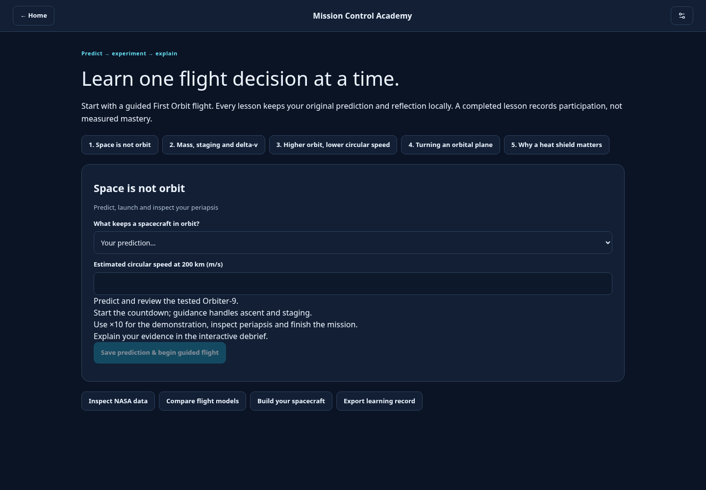
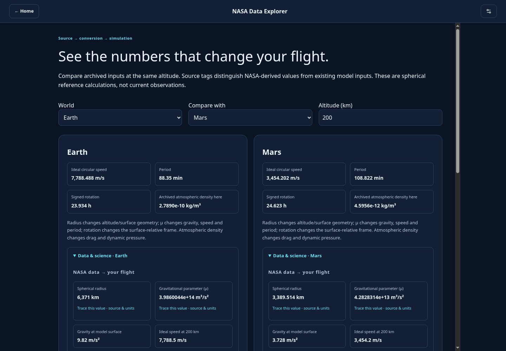
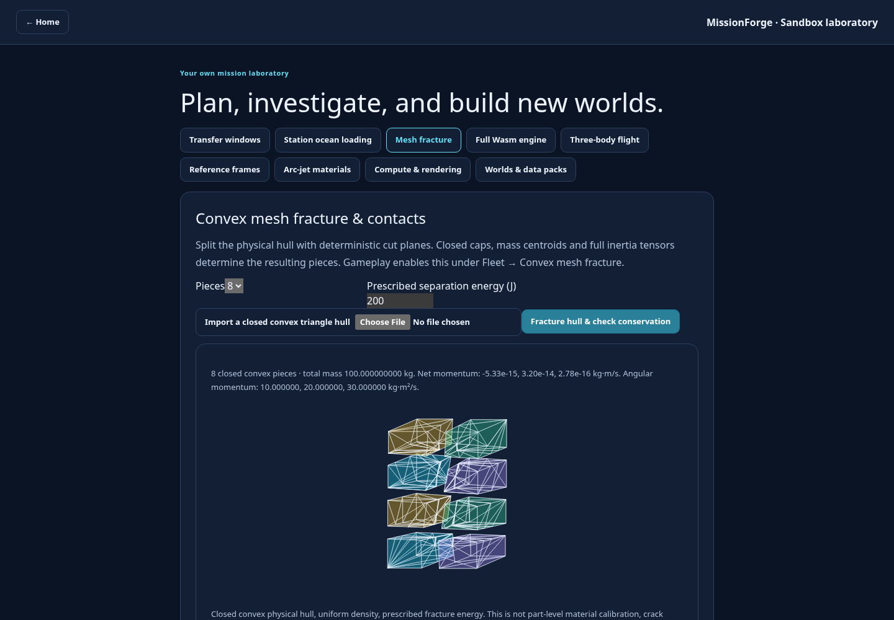
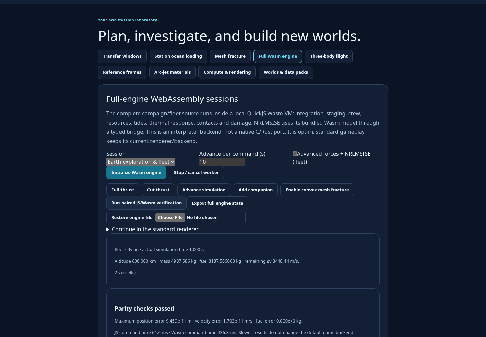

# MissionForge

**Build a rocket. Predict its flight. Use the result to explain what happened.**

MissionForge is a browser-based space engineering and learning game by
**Shashank Pandey**. It combines rocket construction, four scored missions,
solar-system exploration and traceable scientific experiments. No account,
backend, API key or multiplayer service is required.



## Start playing

Choose **First Orbit** for an assisted launch or **Mission Control Academy** for
a predict–fly–reflect lesson. **NASA Data Explorer** shows which source values
affect gravity, orbital speed and atmosphere. Advanced laboratories are optional.

- **Engineering:** 36 construction parts, seven presets, staging, readiness checks,
  fuel and delta-v calculations, three difficulties and mission reports.
- **Learning:** five Academy lessons, first-flight guide, evidence-linked debriefs,
  reflection journal and paired scientific model comparison.
- **Exploration:** eleven destinations, three stock spacecraft, compatible
  single-stage Hangar craft, orbit/system maps, maneuvers, fleets and docking.
- **Science:** sourced planetary constants and atmosphere tables, selectable
  integrators, third-body gravity, harmonics, eclipses, radiation pressure, tides,
  thermal response, power and damage models.
- **New laboratories:** 342-constituent station ocean loading, closed convex mesh
  fracture and complete simulation sessions inside a WebAssembly interpreter.
- **Access:** keyboard remapping, touch steering/throttle/stage/RCS, themes, local
  saves and exports, recovery tools and prepared offline play.



## Run locally

Use **Node.js 24** and npm.

```sh
cd frontend
npm ci
npm start
```

Production build:

```sh
cd frontend
npm run build
python3 -m http.server 8080 --directory build
```

Open `http://localhost:8080`. Serve at the origin root, with WebGL and
WebAssembly enabled. The build includes scientific model assets and the full
engine bundle; no scientific API is needed at runtime.

## Cloudflare Pages

Connect this repository and select `main`.

| Setting | Value |
| --- | --- |
| Root directory | `frontend` |
| Build command | `npm ci && npm run build` |
| Build output directory | `build` |
| Environment variable | `NODE_VERSION=24` |
| Production branch | `main` |

No secrets or server functions are needed. After deployment, verify the actual
Pages URL on desktop and Android, run First Orbit, export/import a save and
prepare offline play. Reload offline only after preparation reports ready.
[Deployment and live checks](docs/deployment.md) distinguish local validation
from checks that must be performed on the final hosted origin.

## Controls

| Action | Default |
| --- | --- |
| Pitch / yaw | W/S and A/D |
| Stage in campaign | Space |
| Full / cut throttle | E / Q |
| Adjust throttle | Shift / Ctrl |
| Pause | P |
| System map in exploration | M |
| Coast warp | Comma / period |

Phone flight reserves a clear camera area, with primary controls in a separate
deck and secondary instruments in a drawer. See [mobile flight layout](docs/mobile-flight-layout.md).

Settings allow remapping. Touch layouts provide steering, throttle, staging and
RCS controls. See the in-game Controls panel for mode-specific bindings and
[the controls guide](docs/controls.md) for the complete reference.

## New engineering laboratories



**Ocean loading:** evaluate 342 constituents from eleven complex BLQ responses,
import station files, inspect hourly displacement and export results. UT1 and
TT-minus-UT1 are explicit. Independent HARDISP series validate the local
components; this is not a bundled global ocean-height atlas.

**Mesh fracture:** split closed convex triangle hulls into 2/4/8 pieces, preserve
mass and momentum, resolve angular contact impulses and save moving debris.
Imported hulls must be convex and closed. Uniform-density inertia and prescribed
separation energy are educational assumptions, not calibrated material failures.

**Full Wasm engine:** run campaign/fleet physics in a cancellable QuickJS Wasm
worker, compare against JavaScript and export or hand off state. All supported
simulation modules are bundled; the NRLMSISE Wasm library uses a typed bridge.
This is an interpreter backend, not a native C/Rust port. Measured slower cases
keep it optional; standard gameplay uses the established JavaScript engine.



## Tests and evidence

```sh
cd frontend
npm test
npm run test:campaign
npm run test:combinations
npm run test:milestones
```

The regression suite contains **321 tests**. The extended release audit runs
30 sequential groups including 621,913 generated catalogue/scenario checks,
12 expected campaign outcomes, 330 emulated device/world/craft cases, learning
flows, optional models, mesh/Wasm labs and offline recovery. These are finite
test matrices; they do not prove every possible trajectory or physical device.

Browser audits need the production build on port 8080 and an isolated Chromium
CDP session on port 9222. See [test setup](docs/testing.md).

```sh
MF_AUDIT_OUTPUT=/tmp/mission-forge-audit npm run audit:release -- --extended
```

[Release notes](docs/release-2026-11-06.md) ·
[Latest recorded release evidence](docs/submission/final-validation.json) ·
[Audit manifest](docs/submission/release-audit/manifest.json) ·
[Strict CI build follow-up](docs/submission/cloudflare-build-fix.json) ·
[Project report](docs/submission/project-report.md) ·
[Presentation](docs/submission/presentation.html) ·
[Three-minute demo](docs/submission/demo-script.md)

## Scientific scope and credits

NASA-derived inputs, third-party models and gameplay assumptions are labelled
separately. Source snapshots and conversions are retained in `data/` and
`frontend/src/science/`. See [NASA data provenance](data/nasa/README.md),
[scientific model notes](docs/third-party-science.md) and
[milestone boundaries](docs/next-milestones.md).

Campaign and exploration use different documented force paths. Fixed/approximate
ephemerides, simplified terrain/materials and sandbox orbit placements are not
presented as mission-design-grade predictions. Emulated tests do not replace
physical-device testing or learner studies. No judging outcome is guaranteed.

Third-party libraries, model sources and data retain their original licences and
notices, including Orekit/IERS loading references and QuickJS. No overall project licence is declared in this repository; third-party
permissions do not grant a licence to the original game code.
