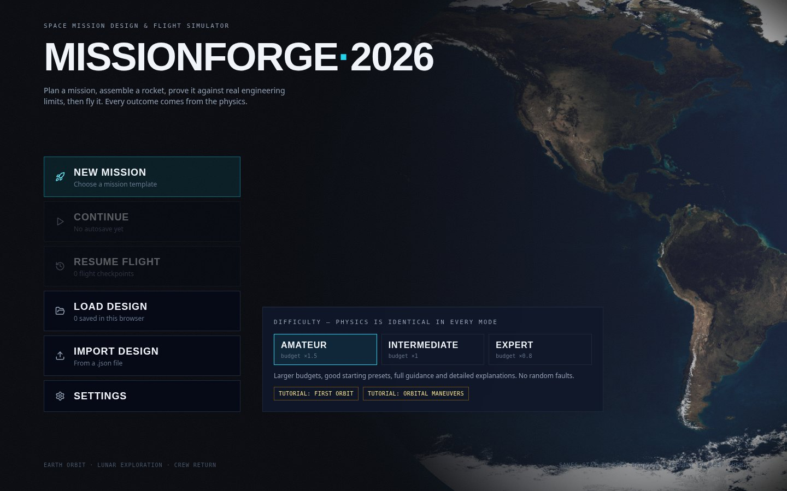
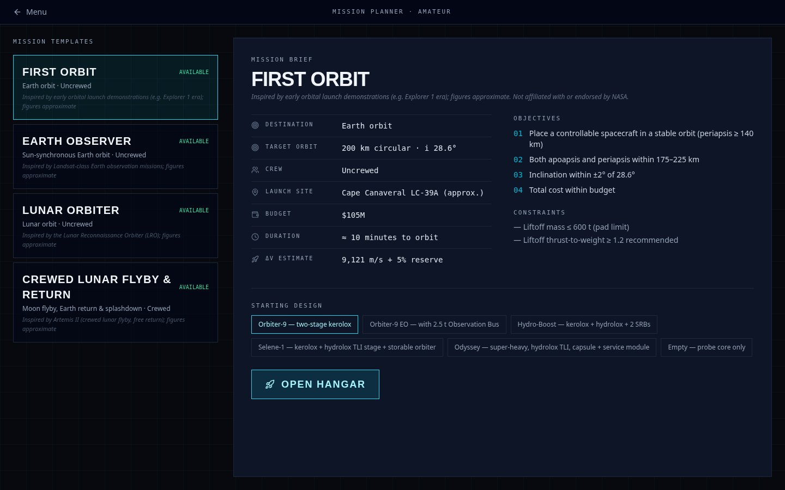

<div align="center">

# Mission-Forge

### Build the rocket. Plan the mission. Fly beyond Earth.

A 3D spaceflight game by **Shashank Pandey**, built for the browser.

[](https://github.com/pandeyshashankai/Mission-Forge/releases/latest)


[Get started](#get-started) · [Missions](#missions) · [Controls](#controls) · [Latest release](https://github.com/pandeyshashankai/Mission-Forge/releases/latest) · [Report a bug](https://github.com/pandeyshashankai/Mission-Forge/issues)

</div>



## Overview

Mission-Forge takes you from a rocket design to an orbital mission and its flight report. Assemble a spacecraft in the 3D Hangar, check whether it can meet the mission's engineering limits, and fly it with assisted guidance or manual controls.

Start with a launch into Earth orbit, deliver an observation satellite, send an orbiter to the Moon, or bring a crew home after a lunar flyby. Fuel, mass, thrust, trajectory, and crew safety determine the outcome.

**No account, backend, database, or API key is required.** The game runs in your browser, and designs and flight checkpoints are saved locally.

## Features

- **3D rocket assembly** — build from engines, tanks, payloads, capsules, boosters, and recovery equipment, with staging, part inspection, and undo/redo.
- **Practical readiness checks** — review propulsion, thrust-to-weight, propellant compatibility, control, budget, power, and mission-specific requirements before launch.
- **Assisted or manual flight** — use guidance and automatic staging, or take control of steering and throttle yourself.
- **Orbital and lunar operations** — plan suggested burns, execute maneuvers with guidance, and use time warp for coasts.
- **Realistic mission consequences** — account for drag, fuel use, spacecraft power, crew supplies, re-entry heating, and acceleration limits.
- **Flight reports and saves** — review objectives, scores, charts, and recommendations; export designs and resume flights from checkpoints.

## Missions

| Mission | Your goal | Focus |
| --- | --- | --- |
| **First Orbit** | Reach a roughly 200 km circular Earth orbit. | Launch, staging, and orbital insertion |
| **Earth Observer** | Deliver an observation satellite to a roughly 700 km sun-synchronous orbit. | Retrograde launch and a two-burn orbital transfer |
| **Lunar Orbiter** | Send a spacecraft to the Moon and capture it into lunar orbit. | Trans-lunar injection, corrections, and orbit insertion |
| **Crewed Lunar Flyby & Return** | Fly three crew past the Moon and return them safely to Earth. | Supplies, return trajectory, re-entry, and splashdown |



## Get started

You need **Node.js 20 or later**, npm, and a modern desktop browser with WebGL enabled.

```sh
git clone https://github.com/pandeyshashankai/Mission-Forge.git
cd Mission-Forge/frontend
npm ci
npm start
```

Open **http://localhost:3000**. A keyboard and mouse or trackpad are recommended.

You can also download the source from the [latest release](https://github.com/pandeyshashankai/Mission-Forge/releases/latest), extract it, and run the same npm commands from its `frontend` folder.

### Your first flight

1. Choose **Amateur**, then **New Mission → First Orbit**.
2. Keep the suggested rocket and open the **Hangar**.
3. Open **Readiness Review** and resolve any failed checks. The advisor explains what needs changing.
4. Proceed to the launch pad. Leave **guidance** and **automatic staging** enabled, then start the countdown.
5. Watch the orbit develop. Complete the mission to see your objectives and flight report.

For Earth Observer and lunar missions, the parking orbit is the first step. Open **Map**, choose a suggested maneuver, and select **Execute with guidance**. Time warp speeds up coasts and reduces automatically near burns.

### Difficulty

| Mode | Budget | Equipment faults |
| --- | --- | --- |
| **Amateur** | Larger mission budget | No random faults |
| **Intermediate** | Standard mission budget | No random faults |
| **Expert** | Tighter mission budget | Seeded hardware faults after reaching orbit |

Flight physics is the same in every mode. Advanced ascent tuning, manual burn adjustments, and the **Engineering** panels are optional.

## Controls

| Input | Action |
| --- | --- |
| `Space` | Stage the vehicle |
| `G` | Toggle flight guidance |
| `W` / `S` | Manual pitch control |
| `A` / `D` | Manual heading control |
| `Shift` / `Ctrl` | Increase / decrease throttle |
| `Z` / `X` | Full throttle / engine cutoff |
| `R` | Toggle reaction control system |
| `M` | Toggle the orbital map |
| `C` | Cycle camera views |
| `,` / `.` | Decrease / increase time warp |
| Drag / scroll in the Hangar | Orbit the camera / zoom |
| `Ctrl+Z` / `Ctrl+Y` in the Hangar | Undo / redo |

Steering or throttle keys hand control back to you. Use `G` to re-engage guidance when needed.

## Saves

Use **Save** in the Hangar to keep a design in the current browser, or **Export** to keep a JSON copy. Import exported designs from the menu or Hangar. **Resume Flight** loads a saved checkpoint.

Browser storage is specific to the browser profile and site address. Clearing site data removes those local saves, so export designs you want to keep. Saves from removed mission types are excluded from Continue and Resume.

## Build and host

From `frontend`:

```sh
npm run build
```

This creates `frontend/build`. From the repository root, serve it locally with:

```sh
python3 -m http.server 8080 --directory frontend/build
```

Open **http://localhost:8080**. Use a web server rather than opening the HTML directly from disk.

The output can be hosted on a static web host. Serve it at the site's root; the current texture paths use `/textures/`. A project subdirectory deployment needs asset-path changes. The repository contains source and assets; the production build is generated locally.

## Technology

| Layer | Technology |
| --- | --- |
| Interface | React 19, Tailwind CSS, Radix UI |
| 3D rendering | Three.js and WebGL |
| Simulation | JavaScript physics and mission systems |
| Flight charts | Recharts |
| Storage | Browser localStorage and JSON import/export |
| Build | React Scripts with CRACO |

```text
Mission-Forge/
├── docs/images/        Screenshots used in this README
├── frontend/
│   ├── public/         HTML entry and Earth/Moon textures
│   ├── src/
│   │   ├── components/ Interface and flight panels
│   │   ├── game/       Game state and design operations
│   │   ├── pages/      Menu, planning, Hangar, flight, and reports
│   │   ├── sim/        Physics, guidance, scoring, and mission systems
│   │   └── three/      Hangar and flight rendering
│   └── package.json    Dependencies and run/build commands
├── CHANGELOG.md
└── README.md
```

## Simulation scope

The game models gravity, Earth rotation and J2, atmosphere and drag, engine thrust and propellant use, attitude control, orbital transfers, power and eclipses, crew supplies, and re-entry limits.

Vehicle figures are approximate. Lunar flight uses patched Earth/Moon gravity and a fixed lunar ellipse; thermal behaviour uses a simplified single-node model. Weather and structural loads are not simulated. Mission examples draw inspiration from real spaceflight and are not affiliated with NASA or other space agencies.

## Troubleshooting

- **Blank or slow 3D view:** enable WebGL/hardware acceleration, update your browser, or choose Low graphics in Settings.
- **Rocket will not launch:** check Readiness Review for insufficient thrust, missing propellant, control, or other failed requirements.
- **A mission reports partial success:** a stable orbit alone may not meet the target altitude, inclination, payload, or return objectives. Read the mission report for the unmet conditions.
- **Missing saves:** check that you are using the same browser profile and site address. Designs exported as JSON can be imported again.

For a reproducible problem, [open an issue](https://github.com/pandeyshashankai/Mission-Forge/issues) with your browser, mission, difficulty, steps to reproduce, and an exported design if relevant.

---

Created by [**Shashank Pandey**](https://github.com/pandeyshashankai). See [CHANGELOG.md](CHANGELOG.md) for release details.
