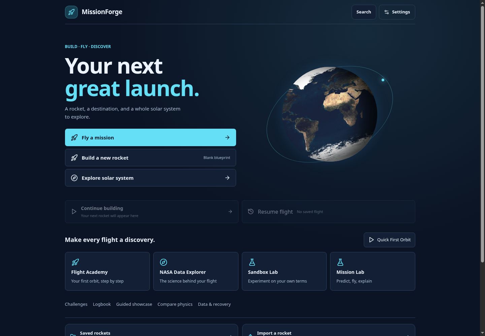
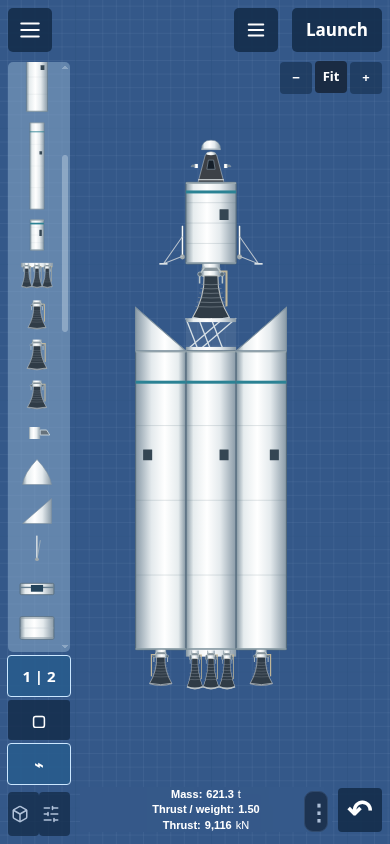

# MissionForge

**Build a rocket. Predict its flight. Explain the result.**

MissionForge is a browser-based space engineering and learning game by
**Shashank Pandey**. Build spacecraft, fly four campaign missions, explore the
solar system and investigate the science behind each result. Gameplay needs no
account, backend, API key or multiplayer service.

[Play MissionForge](https://mission-forge.pandeyshashankai.workers.dev/)



## Play

- **Build a new rocket:** drag parts onto the full-size grid. Use magnetic
  snapping, mirror mode, group editing, pan/zoom and the 3D preview.
- **First Orbit:** inspect readiness, launch, stage and review the flight.
- **Mission Control Academy:** predict an outcome, try an experiment and reflect.
- **NASA Data Explorer:** compare sourced values, units and their effects.
- **Exploration:** choose a destination, practice maneuvers and use orbit maps.
- **Sandbox laboratories:** inspect optional dynamics, thermal, loading,
  fracture and WebAssembly experiments.

The builder has 41 parts and seven presets. Physically disconnected equipment
stays behind; engine mounting and fuel paths affect launch readiness. Flight
shows fuel, Celsius temperatures, shield protection and thermal failures.
Keyboard and touch controls share the same edge-mounted layout. Settings provide
key remapping, themes, local-save recovery and prepared offline play.



## Mission Design Studio

Plan an Earth, Moon or Mars science mission; balance spacecraft, launch and operations budgets; simulate power, eclipses, observations and downlink; and explain the science actually returned. Play solo or with up to four teammates sharing a device. Save locally, compare designs, export reports and share design files or links. No server or account is needed. [Studio guide and model assumptions](docs/mission-design-studio.md).

## Run locally

Use Node.js 24 and npm:

```sh
cd frontend
npm ci
npm start
```

For a production build:

```sh
cd frontend
CI=true npm run build
python3 -m http.server 8080 --directory build
```

Open `http://localhost:8080`. Serve at the origin root with WebGL and WebAssembly
enabled. Scientific model assets are bundled; no live scientific API is needed.

## Deploy on Cloudflare

Connect this repository and use:

| Setting | Value |
| --- | --- |
| Production branch | `main` |
| Root directory | `frontend` |
| Build command | `npm ci && npm run build` |
| Output directory | `build` |
| Environment variable | `NODE_VERSION=24` |

No secrets or server functions are required. Verify the hosted URL on actual
mobile and desktop devices. Prepare offline play before disconnecting.
See [deployment instructions](docs/deployment.md).

## Controls and guides

Use the in-game Controls panel for the current bindings and remapping options.

- [Controls](docs/controls.md)
- [Builder and equipment](docs/builder-studio.md)
- [Drag-and-drop placement](docs/free-placement.md)
- [Flight camera and mobile layout](docs/mobile-flight-layout.md)
- [Heating and shields](docs/flight-heating.md)
- [Academy, Data Explorer and model comparison](docs/connected-learning.md)
- [Scientific models and attribution](docs/third-party-science.md)
- [Performance checks](docs/optimization.md)


## Test

```sh
cd frontend
npm test
npm run test:campaign
npm run test:combinations
```

[Browser-test setup and commands](docs/testing.md) describe the production server,
isolated Chromium session and extended checks. Test output stays outside the
repository by default. CI uploads diagnostic artifacts, including failure details.
Automated coverage is finite; browser emulation does not replace physical-device
checks or establish every possible flight outcome.

## Scientific scope and credits

NASA-derived data, third-party models and educational assumptions are labelled
separately. Original sources and conversions are retained in `data/` and
`frontend/src/science/`. See [NASA provenance](data/nasa/README.md).

Campaign and exploration have different documented force paths. Simplified
terrain, atmosphere, materials and orbit placements are educational approximations.
Station ocean loading is not a global ocean-height atlas. Mesh fracture supports
closed convex hulls. The optional full-engine WebAssembly backend uses an
interpreter rather than a native C/Rust port.

Third-party data and libraries retain their licences and notices. No overall
project licence is declared; third-party permissions do not grant a licence to
the original game code.
