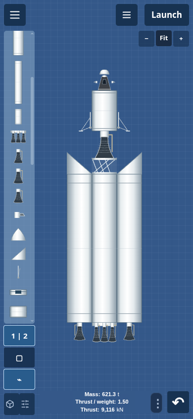
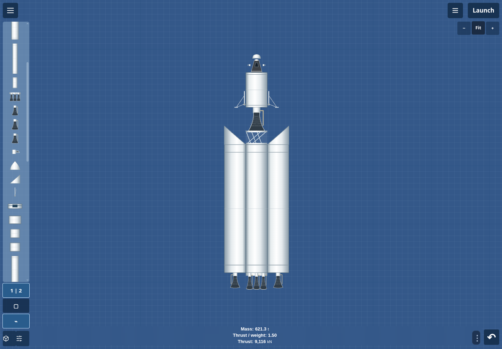
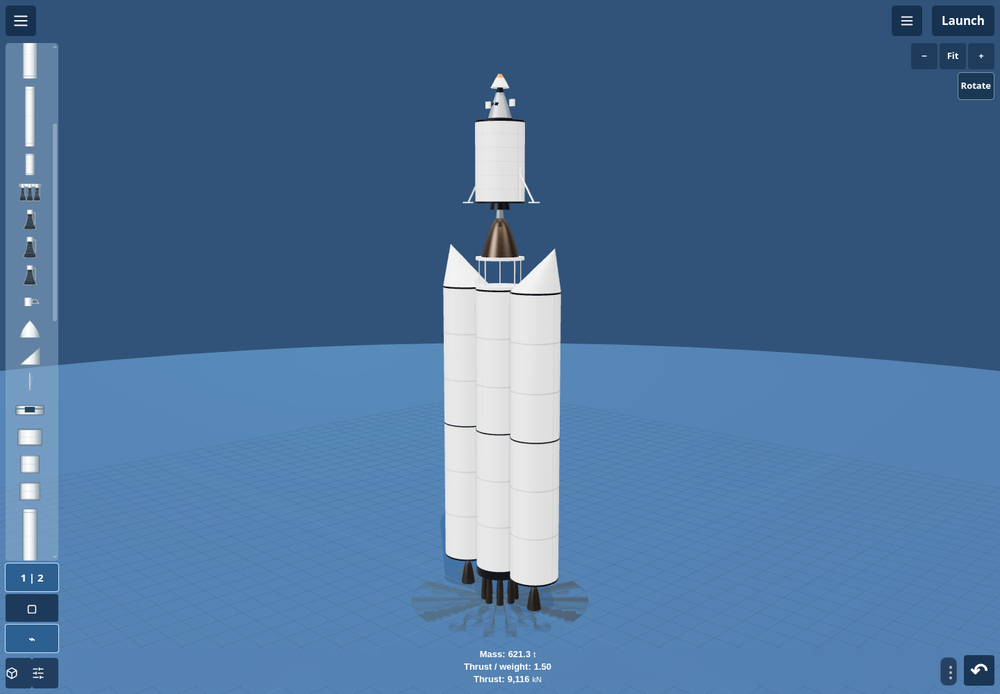

# Rocket construction studio

The builder opens as a full-size blue grid on phones, tablets and computers.
The slim palette, launch button and editing tools float over the workspace.
All artwork is original; the interaction reference was the supplied one-minute
beginner rocket-building video.

## Build and navigate

- Open the upper-left menu for **New blank rocket**, presets, naming, saves,
  import/export, undo/redo and display settings. Existing recommended mission
  rockets remain available.
- Drag a palette silhouette directly onto the grid, or tap to pick it up and
  tap the grid to place it. Escape or Cancel puts it away. Use the bottom-left
  Parts button for the searchable catalog and categories.
- Drag empty grid to pan in any direction. Scroll pans; Ctrl + scroll zooms
  around the pointer. Two fingers pan/zoom on touchscreens. The corner +/− and
  Fit controls are available on every device. Adding or moving parts preserves
  the camera; Fit is an explicit action.
- Snap finds nearby top, bottom and side connections; otherwise it uses a
  quarter-metre grid. Turn Snap off for exact free placement. Existing equipment
  stays where it was placed instead of being pushed into one vertical column.
- **1 | 2** mirrors new side equipment about the central axis. Add a side fuel
  tank, then an engine beneath it, to make a paired liquid booster assembly.
- Tap a placed part to select it, or use the rectangle tool to select a group.
  Shift-drag also selects a rectangle; Shift-click adds/removes a selection.
  Drag the group, copy it, rotate 90°, flip horizontally/vertically, inspect or
  delete it. Attached children travel with their parent. Ctrl+D copies,
  Delete removes, Ctrl+Z undoes and Ctrl+Shift+Z/Ctrl+Y redoes.
- The upper-right view menu opens the 3D preview, fairing interior, mass/thrust
  markers, solid-booster copy counts and detailed staging/science panels.
  Mass, thrust and thrust/weight stay visible beneath the rocket.

## Equipment and simulation

The catalog now contains **41 parts**, including five additions: a normal nose
cone, a slanted nose cone, a truss stage separator, a small RCS block and landing
legs. Their dimensions, masses and capabilities are educational approximations,
not new NASA-calibrated spacecraft hardware data.

Side tanks and engines add actual fuel, dry mass, cost and thrust. Compatible
fuel is shared within the parent stage, and side parts separate with that stage.
A rotated engine changes the thrust vector as well as its appearance; an
upside-down engine cannot lift a rocket. RCS blocks use the existing attitude
and monopropellant model. Select a landing leg and open Properties to deploy it;
with Mirror enabled, its partner deploys too. At least two deployed legs allow
an upright touchdown at up to 6 m/s. Faster or badly tilted impacts still crash.
The flight report can be opened after a touchdown.

A blank blueprint can be saved/restored, but cannot launch until equipment is
added. Free positions, orientation, mirror artwork and leg deployment survive
save/import. Older rockets retain their original stack layout until edited.

Attachment links represent an ideal rigid assembly, not automatically solved
welds or geometric mesh contact. Position does not create individual fuel lines,
independent side-branch staging or a full off-axis engine torque solution. Core
separators define liquid stages; solid booster groups retain their existing
jettison events. Readiness remains the place to check control, matching fuel,
TWR and mission delta-v before launch.

## Verification

Run from `frontend` against the production build/browser session:

```sh
npm test
CI=true npm run build
npm run test:studio:ui
npm run test:assembly:mobile
npm run test:assembly:ui
npm run test:controls
npm run test:cockpit:ui
npm run test:ui
npm run test:persistence:ui
```

The studio audit constructs the full reference-style rocket using native
pointer drags: capsule/chute, upper tank/engine, mirrored deployed legs, a truss
separator, a lower core, paired liquid boosters, slanted nose cones and RCS.
It checks stable camera framing, rectangle selection, copy/rotate/undo/delete,
five viewport layouts, 3D preview and save/resume. The assembly flight audit
flies a custom side-tank/engine design through guided orbital insertion.
The unit checks cover empty drafts, physical propulsion, poses, transforms,
import validation and soft versus destructive landing outcomes.

See the [recorded validation results](builder-studio-validation.md).

Browser device layouts are Chromium emulation, not physical-device certification.






