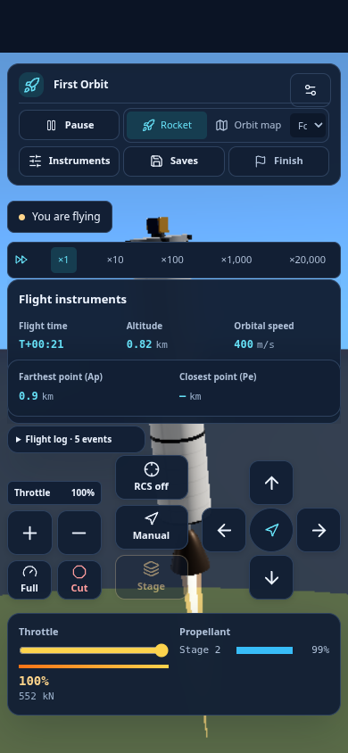
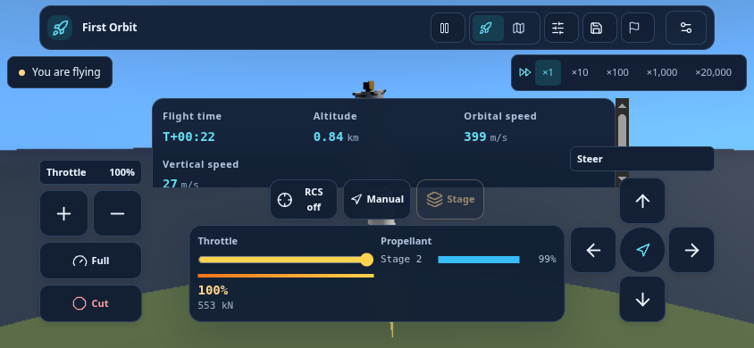

# Device controls

Flight and solar exploration share keyboard and touch controls. Open **Settings → Controls** from the menu or flight header. Escape opens Settings during flight.

## Keyboard and mouse

| Action                       | Default      |
| ---------------------------- | ------------ |
| Pitch forward / back         | W / S        |
| Turn left / right            | A / D        |
| Increase / decrease throttle | Shift / Ctrl |
| Full thrust / cut engine     | E / Q        |
| Next stage                   | Space        |
| Toggle RCS                   | R            |
| Toggle mission guidance      | G            |
| Pause / resume               | P            |
| Orbit map                    | M            |
| Change camera                | C            |
| Slower / faster time         | , / .        |

Click a binding and press its replacement key. Escape cancels capture. Assigning a key already in use swaps the two actions so neither loses its binding. Choose **WASD defaults** or **Arrow keys** to restore a preset. Bindings and device preferences persist locally in this browser. Letter bindings use physical key positions; displayed labels follow those bindings. Browser shortcuts and reserved navigation keys are unavailable for assignment.

Flight steering uses held keys, including simultaneous steering and throttle. Manual steering or throttle takes over from mission guidance and returns time speed to ×1. Opening a dialog, switching away from the window, or rotating/resizing the screen releases held inputs. Pausing blocks thrust and staging while still allowing camera and map changes.

Use the mouse to orbit the 3D view and the wheel to zoom. Builder selection and its editor shortcuts remain separate from flight bindings.

## Phones and tablets

Auto shows the full on-screen cockpit on phones and computers. Desktop buttons show their currently assigned keys underneath; guidance and stage fuel remain directly visible. **Touch controls** can also be forced on or hidden on a laptop or tablet with a keyboard. Choose left- or right-side steering, normal or large buttons, and steering sensitivity in Settings.

- Hold the arrow pad to steer. Drag the vertical throttle upwards to increase thrust, or hold **+ / −**. **Full / Cut** set it immediately.
- Tap **Stage**, **RCS**, and **Auto / Manual** for mission actions. Stage becomes unavailable after the last stage.
- Steering, throttle, and action taps work together with multiple fingers. Releasing or cancelling one pointer leaves the others active.
- Use the corner shortcuts for Map, pause, Instruments and time speed. Menu opens camera options, saves and the remaining flight tools.
- Pick up a palette part and drop it on the build grid. Drag placed parts to reposition them. Drag empty grid or scroll to pan; pinch or use +/− to zoom, and Fit to see the entire rocket. 3D preview also has Pan/Rotate and Fit controls.

The flight camera fills the workspace on phones, tablets and desktops. Button backgrounds are 20% transparent; labels stay opaque. The layout accommodates portrait, landscape, and browser-provided notch and home-indicator insets. Short screens keep extra telemetry in **Instruments** so the flight buttons remain accessible.

## Solar exploration

Exploration uses the same steering, throttle, pause, map, camera, and time-speed bindings. Its craft are single-stage, so the stage button explains that limitation. Mission guidance is available in scored missions only.

Exploration RCS is an ideal attitude-hold model: when switched off, it holds the current burn direction; switching it on resumes the selected steering mode. It does not simulate separate RCS propellant or thruster torque.

## Validation

Run `npm test`, `npm run build`, and `npm run test:campaign` from `frontend`. For native Chromium keyboard, mouse, and multi-touch checks, serve the production build on port 8080, start Chromium with remote debugging on port 9222, then run `npm run test:controls`.

The browser suite covers remapping, persistence, simultaneous inputs, independent pointer release, cancellation, pause and Settings isolation, stage guards, RCS, both keyboard presets, touch visibility, handedness, large buttons, safe-area hit testing, and opening a failure report on a short phone screen. Viewports include 390×844, 844×390, 768×1024, 1024×768, and 1440×1000. These are browser-emulated checks; physical iOS/Android hardware and every browser/device combination have not been certified. Optional gamepad support now provides remappable buttons and axes, deadzone and pitch inversion, neutral arming after connection, and release on disconnect, blur or modal input. Wake lock and haptics are opt-in capability-dependent options. Automated gamepad checks use synthetic API fixtures; physical controllers still require hardware testing.

## Exploration transfer assistant

Open **Orbit transfer** in the exploration inspector, enter a nearby target altitude, and start the first finite burn. Coast using the time-speed controls; the simulation holds at the circularization window until you confirm the second burn. The result shows the achieved orbit rather than an exact-target promise.

Steering, throttle, RCS, or burn-direction input cancels assistance and cuts its thrust before returning control. The cancel button also cuts thrust. A restored save always has engines off and no armed transfer. The assistant requires a near-circular start, enough propellant, a safe atmospheric/surface margin, a target inside the body's sphere of influence, and burns short enough for the approximation.

### Side profile and whole-rocket editing

Fresh settings start scored flights in **Side**. The on-screen **Side / 3D / Focus**
shortcuts stay outside the central flight view. In Side, drag empty scene space
to pan and pinch or use the mouse wheel to zoom; **Focus** recenters the craft.
Wheel zoom also works in 3D follow. **Map** returns to the preceding craft view.
The flight menu still offers cinematic and free cameras. Exploration's Craft
view has its own Side/3D switch; Fleet retains its formation view.

Palette equipment follows the pointer at its center. Keep dragging from the
palette to the grid and release to place it. A tap followed by a grid tap does
not place equipment. Choose **Tools → Select whole rocket** or press **Ctrl+A**
(**Cmd+A** on macOS) outside an input to use the existing group operations on
the entire assembly. Individual selection keeps a thin border.

At the end of a flight, **Edit rocket** returns to construction and **Retry launch**
returns to readiness review. Both record the attempt before leaving the flight.
