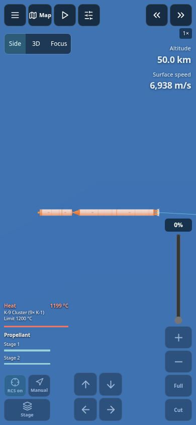
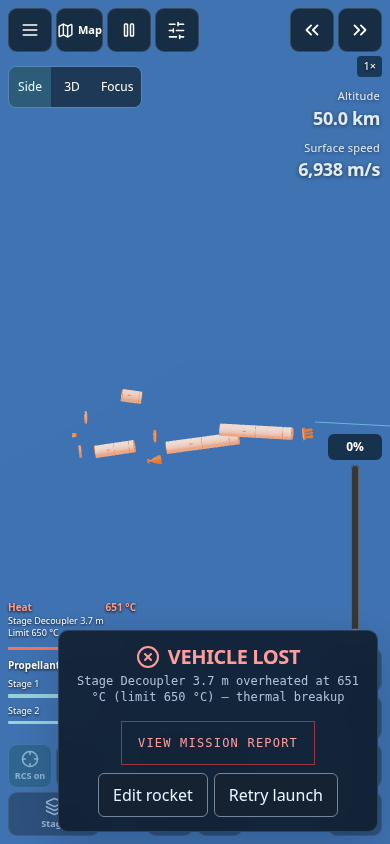

# Flight heating, shields and Celsius damage

Campaign flights now track skin temperature for every attached construction part,
including solid-booster groups. The heat display sits above the fuel bars and
shows the part closest to its limit, its temperature in °C and its failure limit.
It remains visible in keyboard-only mode. Shield percentage represents remaining
heat-load capacity, not a direct measurement of remaining ablator mass.

At the configured temperature limit, the vehicle is destroyed, throttle is cut,
and the report names the failed part, measured temperature and limit. The visible
rocket separates into component meshes. The breakup animation is cosmetic after
the terminal flight event; it does not introduce a new debris collision solver.

## Heat model

Existing atmospheric density and surface-relative speed drive the Sutton–Graves
stagnation-heating approximation. A lumped skin balance integrates absorbed heat
and radiative cooling in kelvin; the interface converts with `°C = K − 273.15`.
Part area, an assumed effective skin mass, heat capacity, emissivity, exposure,
shield alignment and existing shield heat-load capacity affect the result.

| Construction family | Gameplay failure temperature |
| --- | --- |
| Ablative shield surface | 2800 °C |
| Engines / solid boosters | 1200 °C |
| General structure and tanks | 650 °C |
| Avionics, capsules and payloads | 250 °C |
| Parachute pack | 220 °C |
| Solar panels | 180 °C |

These are **simulation material ratings**, not NASA-qualified component limits.
The basic skin-mass/exposure/insulation values are educational assumptions, not
calibrated finite-element or computational-fluid-dynamics models. More detailed
TPSX/material tools remain available in the scientific laboratories.

An aligned shield protects parts within its nominal diameter while capacity
remains. Its existing 7 MW/m² peak-flux and 40 kJ/cm² integrated-load guards also
remain; these can fail a shield independently of its temperature rating.
Uncrewed shielded assemblies consume the heat-load budget too. Unshielded bodies
now warm progressively rather than being destroyed cold by the old bare-capsule
instantaneous heat-flux rule. A reversed or exhausted shield loses its insulating
benefit. The existing blunt-capsule attitude assistance remains in the entry model.

Cold vacuum does not produce plasma heating. Skin temperatures radiate down over
time and heat flux is cleared after atmosphere exit. Individual parts become
emissive as their temperatures approach their limits; a translucent bow glow and
wake follow atmospheric heating. Heating effects do not require rapid flashing.

## Exploration

With the existing thermal-damage option enabled, exploration exposes hull/backing
°C and its selected material limit alongside fuel. Crossing that hull-temperature
limit triggers the existing structural/mesh breakup path. TPSX modes display
backing temperature, matching their failure calculation. The existing optional
model settings and material selection remain available. The exploration model's
existing atmospheric-heating scope is unchanged.

## Persistence and verification

Temperatures, peak temperatures, warnings, failure and shield capacity survive
campaign saves. Imports reject invalid temperatures, unknown part IDs and invalid
thermal state. A restore must use the checkpoint's original blueprint identifiers;
creating another copy of a preset generates different part IDs.

Tests include ordinary launches, unshielded heating, aligned/reversed/exhausted
shields, booster groups, radiation cooling, progressive heating, uncrewed shield
capacity, save round trips and tampered-state rejection. Browser tests use a
paused, deliberately hot reentry fixture to exercise warnings, exact °C failure
messages and visible breakup quickly; that fixture is not a measured reentry
trajectory. Independent integrated heating tests start from ambient temperature.

## Release checks

- Production build passed with `CI=true`.
- **366 unit/simulation checks passed**, including ten new heating cases.
- All four prepared campaign mission runs succeeded with heating active.
- Browser suites passed for heating/breakup, 16 cockpit layouts, persistence and
  camera/navigation workflows. The final interaction check also opens the thermal
  failure report with a real pointer click and checks exploration's keyboard-only
  heat display.
- The thermal terminal card stays in a corner so the breakup remains visible.

Commands: `npm test`, `npm run test:missions`,
`npm run test:flight-thermal:ui`, `npm run test:cockpit:ui`,
`npm run test:persistence:ui`, `npm run test:profile-view:ui` (from `frontend`).

