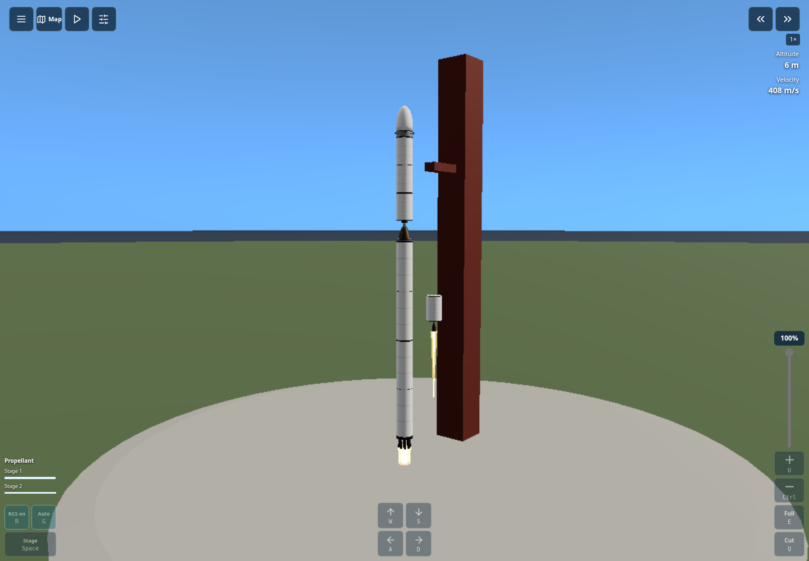
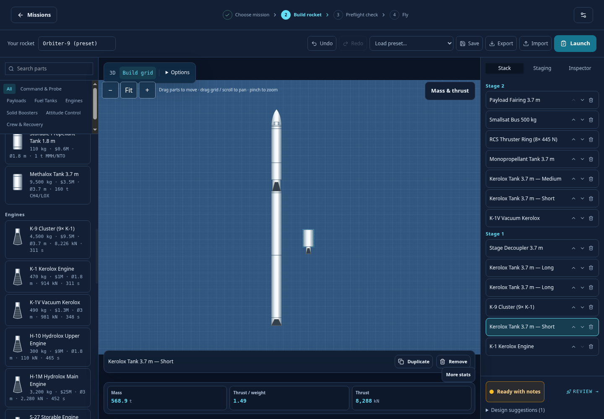
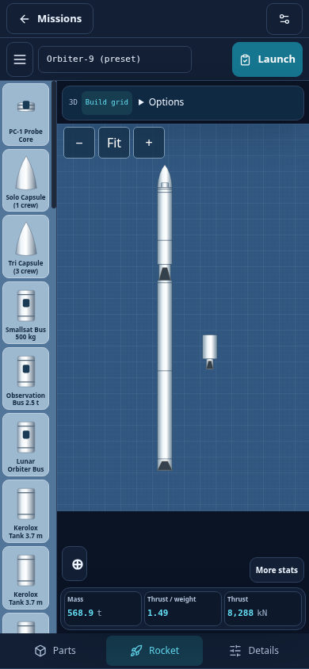
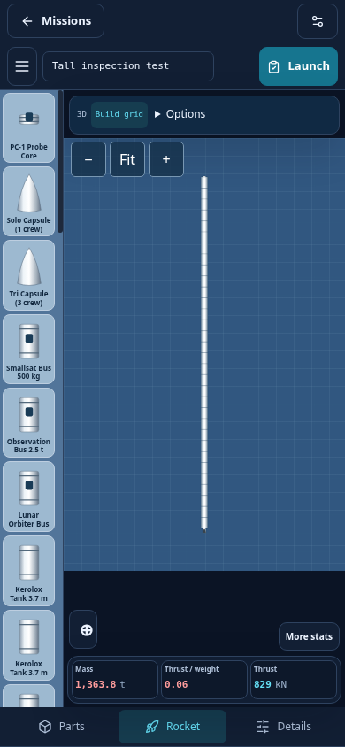

# Picking up and placing rocket parts

The full-grid studio now adds symmetry, group editing, stable framing and new
equipment. See the [current builder guide](builder-studio.md).

Press and hold a palette part, drag it onto the grid, then release to place it.
Use one continuous mouse or finger gesture. A tap/click alone does not arm placement.
There is no Above/Below/Beside choice. Nearby connection points snap into place;
otherwise the part keeps its chosen position on the grid, rounded to 0.25 m.
Cancel or Escape puts the held part away without adding it.

Drag an existing part to reposition it. Its attached children move with it. Drag
empty grid or use the mouse wheel to pan, including up/down along a tall rocket.
Pinch, Ctrl+wheel or +/− zooms. Fit brings the whole craft back into view. The
3D preview has Pan/Rotate, zoom and Fit controls as well.

Side tanks add propellant and mass; liquid engines add thrust and consume the
compatible propellant in their parent stage. Positions are used by the grid,
3D preview and engineering mass/thrust-centre calculations, and survive saves,
imports, reusable-stage copies and compatible exploration transfers. Removing
a parent removes its attached children. Stage separation removes that stage's
side equipment too. Side liquid engines have their own visible exhaust.

This is a 2D placement grid with a 3D preview. Attachment links define an ideal
rigid assembly with common compatible stage fuel, orientation-dependent engine thrust and
common throttle. Placement is not a mesh-contact/weld solver: off-axis torque,
individual engine plumbing and independently staged side branches are not
resolved by this builder. Stage separators belong in the central stack; the
existing solid-booster groups retain their dedicated jettison events. Use
balanced side assemblies and review readiness before launch.

## Desktop cockpit

Auto now displays the same corner/edge controls on computers as on phones:
throttle percentage and slider, +/−, Full/Cut, steering, RCS, Auto guidance,
staging and per-stage propellant meters. Key labels follow Settings → Controls;
defaults remain W/S and A/D steering, Shift/Ctrl throttle, E/Q Full/Cut, G guidance,
R RCS and Space staging. Keyboard-only remains an explicit option to hide the
on-screen controls. Mobile controls retain their compact layout without key labels.

The retired English and Hindi 1080p tutorials were removed from the current Git
branch. New recordings can be made after the revised interface is reviewed.

## Verification

From frontend, run `npm test`, `npm run build`, `npm run test:assembly:ui`,
`npm run test:assembly:mobile`, `npm run test:controls`, `npm run test:cockpit:ui`,
`npm run test:ui` and `npm run test:persistence:ui` against the production browser
session. The assembly audit uses native pointer events and flies the side-tank /
side-engine rocket through a complete guided orbital mission. Hardware testing
is still separate from Chromium emulation.

## Screenshots

