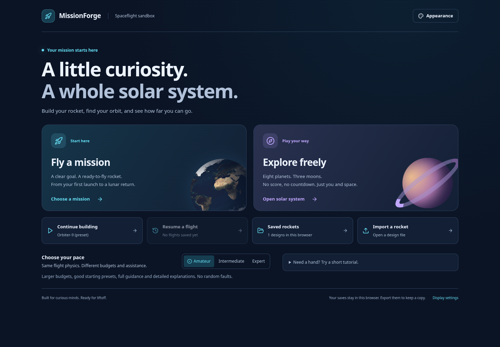
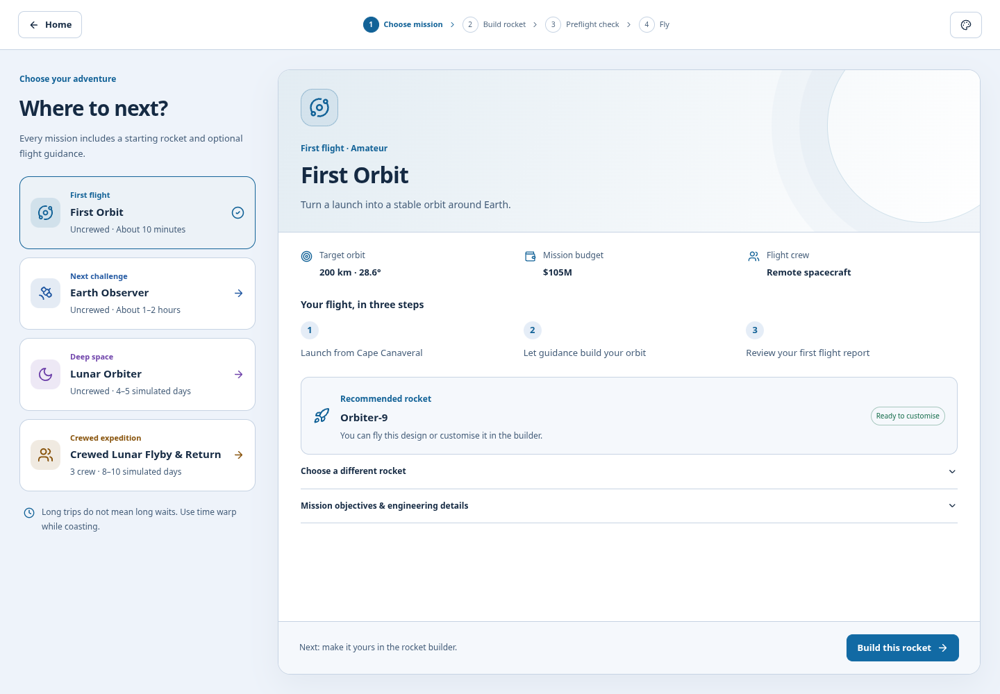
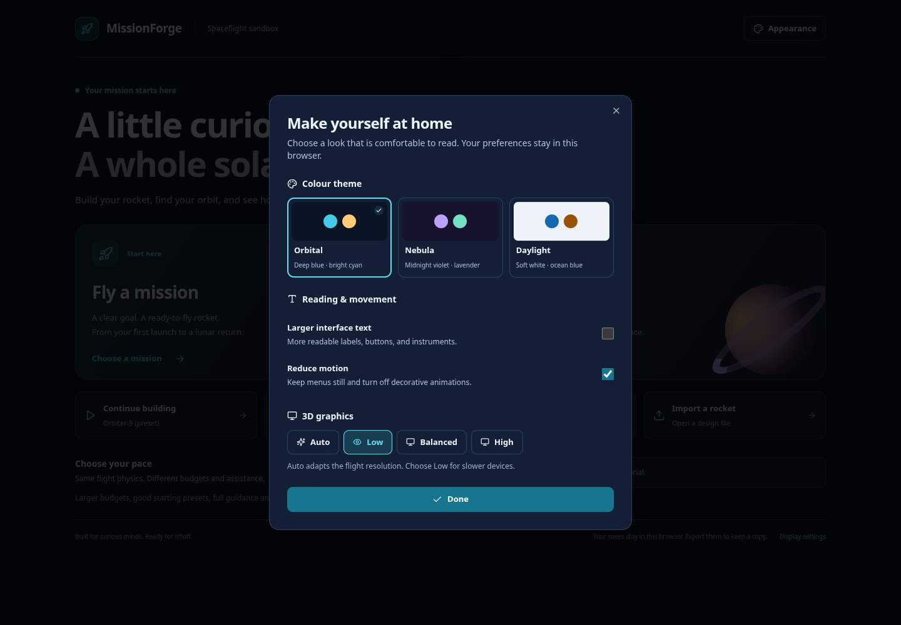
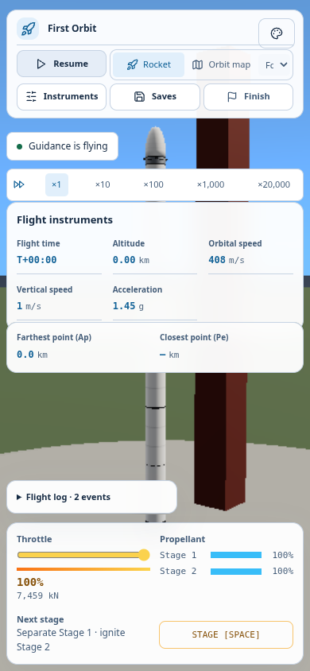

# Interface review and changes

Reviewed on 2026-11-03.

## Reference material

| Reference | Material available in this environment | Useful direction |
| --- | --- | --- |
| Kerbal Space Program / RP-1 community | [RP-1 wiki](https://github.com/KSP-RO/RP-1/wiki) and [early-career tutorial](https://github.com/KSP-RO/RP-1/wiki/Early-Career-Tutorial) | A clear progression from choosing a goal to preparing and flying a vehicle; keep mission context visible during construction. This is community documentation, not an evaluation of the current stock KSP interface. |
| Orbiter | [Project overview](https://github.com/orbitersim/orbiter) | Precise instruments and self-directed flight are valuable, but instrumentation should be available on demand rather than compete with the first action. |
| Pioneer | [Project overview and flight documentation index](https://github.com/pioneerspacesim/pioneer) | Distinguish open-ended exploration from objective-led missions, with a visible route back to the player's current work. |
| Spaceflight Simulator, Juno: New Origins, stock KSP | Their Steam product pages were requested, but the environment returned network-policy denials. | Their familiar assembly, orbital-map, and engineering concepts remain comparison points from established product knowledge. A current commercial UI review or hands-on usability benchmark was not possible here. |

No interface assets or source code were copied from these products. This update adopts familiar flight conventions and keeps MissionForge's own visual language.

## Problems addressed

The previous interface placed many small, equally weighted controls on every screen. Secondary controls looked as important as starting a mission. Small labels and dark colours made the builder and flight panels hard to scan. The mission planner showed every rocket and all engineering constraints at once, while the next action could disappear below the fold.

The revised interface uses the following structure:

- **Home:** two primary paths, Fly a mission and Explore freely. Continuing work, saved flights, designs, and import are secondary actions.
- **Mission planner:** distinct mission cards, plain-language summaries, three flight steps, and one recommended rocket. Alternative rockets and engineering details expand when needed. The next action stays outside the desktop scrolling brief.
- **Builder:** a persistent Choose → Build → Check → Fly progress indicator, clear save/import controls, selectable 3D/blueprint views, and direct duplicate/remove actions. Selecting a part opens its inspector. Narrow screens use Parts, Rocket, and Details panels.
- **Preflight:** a plain verdict, separate passed/advisory/fix counts, and an attention-first list. Calculations remain accessible. Launch failures require an explicit test-flight choice.
- **Flight:** essential telemetry first, with additional instruments behind Instruments. Farthest/closest point labels explain Ap/Pe. Camera, time speed, guidance, saves, and finish actions are grouped. Finishing a flight requires confirmation; saves and display settings pause the simulation while open.
- **Exploration:** clearer metric names, shared appearance settings, paused 3D rendering behind the system map, and a destination selector on narrow screens.

## Appearance and readability

Orbital uses deep blue and cyan; Nebula uses violet and lavender; Daylight uses soft white and ocean blue. The selection persists after a reload and applies to menus, controls, dialogs, panels, and report charts. Space itself retains its dark background.

Larger text and reduced-motion preferences are available in Appearance. The OS reduced-motion preference is also respected for decorative animations. Interface fonts use the local system stack, so a blocked font service does not delay reading the interface.

The automated contrast checks require at least 4.5:1 for primary, secondary, status, and accent text on the theme's main surfaces and for white text on primary buttons. This is a palette check, not a complete accessibility certification. Focus outlines, named icon buttons, visible text labels, and keyboard-operable controls support the reading changes.

## Bugs found during this review

- Selene-1's recommended rocket exceeded the Lunar Orbiter mission's 600 t pad configuration. Its heavy-launch allowance is now 700 t, consistent with the supplied 632.6 t design. No gravity or propellant values were changed to make it pass.
- A narrow mission-picker column could shrink to zero height and paint its cards underneath the brief. Its intrinsic height is now preserved.
- Undo history mutated arrays inside React state updaters, which could create duplicate history entries under development checks. A pure history reducer now handles edits, undo, redo, and loading.
- Starting exploration used to create an unrelated mission-building autosave. Only builder, review, and flight screens now save that work.
- Malformed saved-list shapes could crash the main menu; list reads now validate their container shape.
- The system map kept rendering the hidden 3D scene. Rendering now pauses while the map covers it.
- Preset budget advice was missing in the mission brief. An over-budget starter now says what needs changing before launch.

## Scope of validation

See [flight validation](flight-validation.md) for the test commands and observed results. All named presets and destinations are exercised, but arbitrary user-built rockets and every possible flight trajectory are not exhaustively tested. The supplied Selene-1 deliberately exceeds the Expert lunar budget: its flight succeeds, and the stock design earns partial success until its cost is reduced. The interface reports that condition rather than treating it as a ready-to-launch design.

## Screenshots

