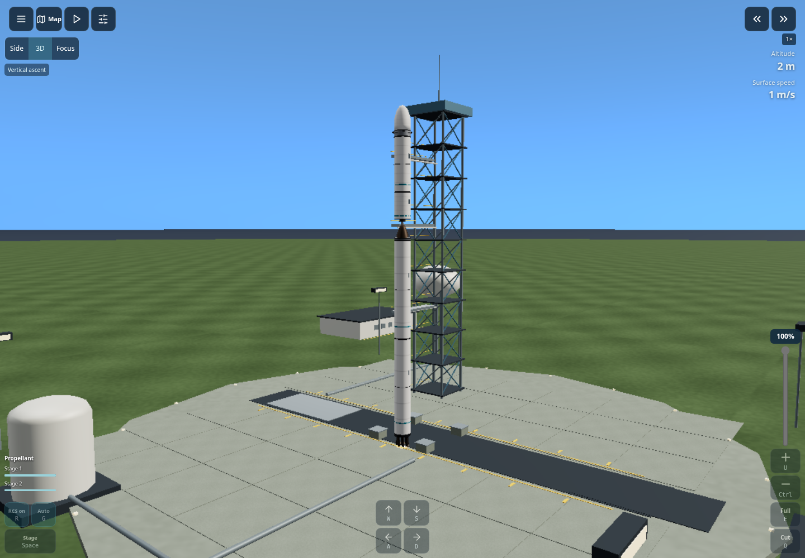

# Launch ownership, guidance transitions and cockpit refresh

Disconnected equipment now belongs to the launch site, not the flying vessel.
The command-connected component supplies flight mass, resources, crew, engines,
staging and camera bounds. The complete blueprint remains in the editor. Loose
parts are rendered in the rotating Earth-fixed launch-station frame, with a
simple vertical gravity settling animation to the pad/ground. They cannot follow
the vessel or contribute fuel. This scenery animation is not a full loose-body
collision solver. Stored flights retain and validate the parked-equipment design.

Readiness uses the connected launch assembly's mass and warns about equipment
that will stay behind. An invalid mount link cannot attach a distant part. The
existing contact graph uses build-part bounding boxes and a 0.15 m grid allowance.

Guidance corrections address specific reproduced transition problems:

- Missing thrust during insertion no longer falsely completes guidance.
- Successful insertion cuts thrust and holds the actual current attitude instead
  of immediately switching the vessel to prograde tracking.
- Every staging event resets the automatic staging timer, including manual ones;
  a nearly expired timer cannot immediately trigger the next automatic event.
- The flight screen shows the current guidance phase or a waiting-for-thrust
  message. Detailed instruments retain the explanation.
- Routine staging/resume toasts no longer obscure the center of the flight view;
  the fuel/stage controls and mission event log provide the confirmation.

Existing torque limits, fuel use and force models remain in effect. This does
not claim to eliminate every possible instability in an asymmetric or poorly
controlled design. Direct command slew limiting was evaluated and rejected
because it degraded the prepared ascent; the physical attitude controller
continues to handle turns.

The refreshed cockpit has quieter borders, consistent active colors, grouped
camera buttons and clearer numeric readings. Equipment has original tank
identification bands, reinforced end rings and service panels in both the build
artwork and 3D models. The launch station adds service buildings, support
pedestals and perimeter lights, with a muted gantry palette. Static details
continue to share instanced batches.

The deterministic showcase baseline was updated for the intended post-insertion
attitude change. Final time, position, velocity and orbit are identical to the
previous reference; holding attitude saves approximately 2.651 kg of RCS fuel.
The new checkpoint hash is `1a410dc8`, compared with `6ec55bdd` previously.

## Validation

- Strict production build passed.
- Full unit/simulation suite: **356 passed, zero failures**.
- All four prepared mission runs succeeded: First Orbit, Earth Observer, lunar
  orbiter and crewed lunar flyby/return.
- Five browser suites passed: engine connection/parked equipment, camera/profile
  workflow, 16 cockpit device layouts, IndexedDB save/recovery/backup validation,
  and native side-booster construction through a successful orbital report.
- Updated touchdown fixtures mount their legs against the tank; floating legs
  are no longer implicitly counted as landing gear on a flying vessel.

[Phone cockpit](images/refreshed-cockpit-phone.png)
