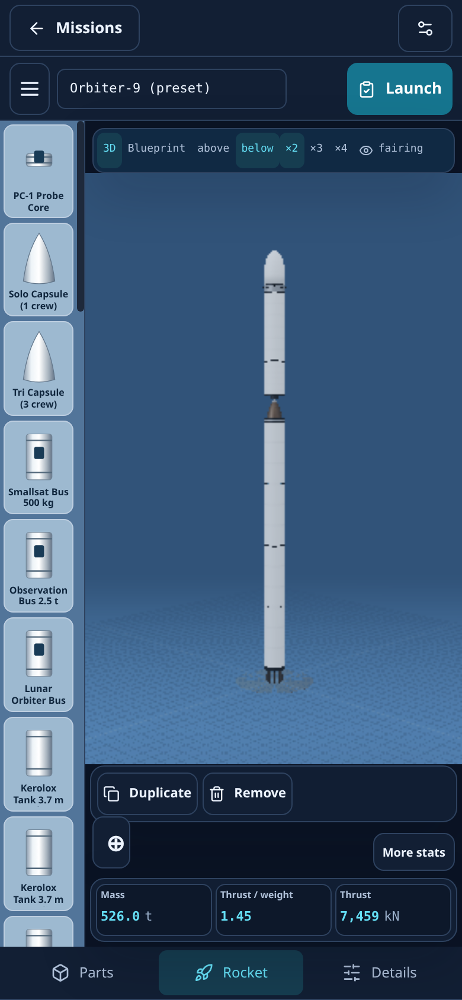
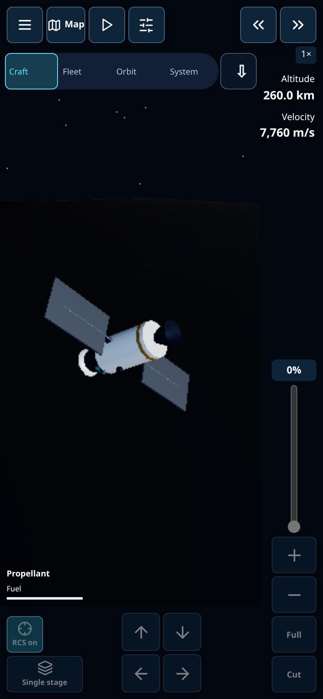
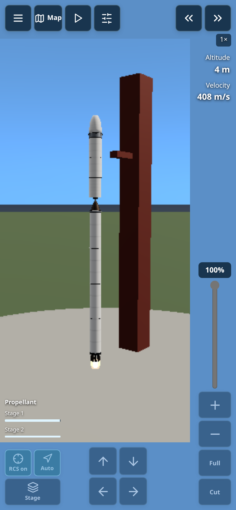

# Mobile flight visibility

The compact cockpit keeps a dedicated camera window clear of its primary
controls. The renderer resizes to that window, centring the spacecraft in the
visible area. Desktop instruments and keyboard bindings remain available.

- Top left: Menu, Map, pause/resume and Instruments. Menu reveals the existing
  flight tools, camera choices, saves and settings in a scrollable panel.
- Top right: time-speed buttons, altitude and velocity.
- Right edge: a native vertical throttle slider, plus/minus, Full and Cut.
  Sliding upwards increases thrust. Pausing disables flight input.
- Bottom: steering arrows, RCS, guidance and staging. Propellant meters remain
  visible. Handedness settings mirror the controls; safe-area insets protect
  buttons from notches and home indicators.
- Exploration retains Craft, Fleet, Orbit and System views, capture and the
  scrollable instruments/destinations drawer. NASA Data Explorer, Academy,
  Mission Lab and Sandbox remain accessible from the home menu.

The phone builder uses a blue drafting workspace and a persistent part-icon
rail. Parts expands search and filters; Build returns to the spacecraft;
Details opens the inspector. Selecting a part keeps the workspace visible.
Tools contains the existing build actions. Mass, thrust and TWR stay visible;
More stats reveals the remaining engineering values. Launch opens readiness
review. Both the 3D workspace and selectable blueprint remain available.

## Verification

Run these against the production build and browser debugging session:

```
npm run test:cockpit:ui
npm run test:controls
npm run test:mobile-visibility:ui
```

The cockpit suite checks 15 camera layouts across phones, landscape, tablets,
handedness and simulated notches; real touch events for simultaneous steering
and throttle; independent pointer release; cut/pause; instruments, map, saves;
and builder part selection, search, statistics and original menu access.
These are Chromium emulation checks, not physical-device certification.

## Current screenshots






