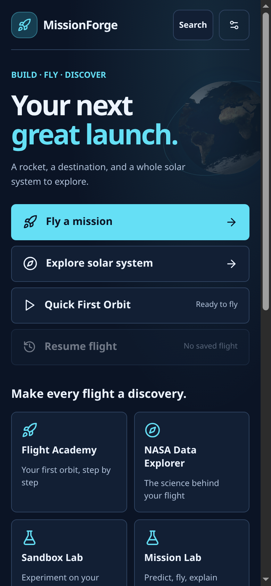
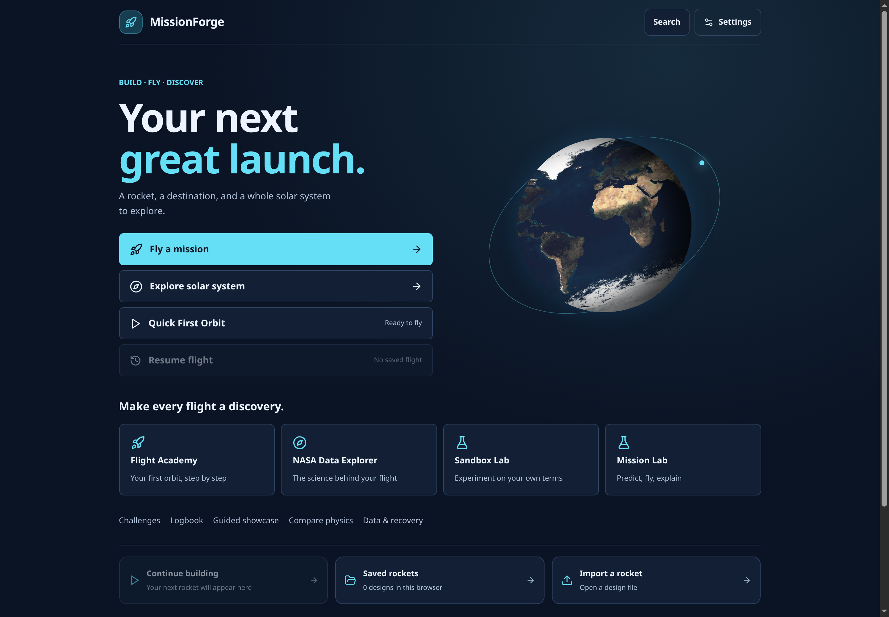
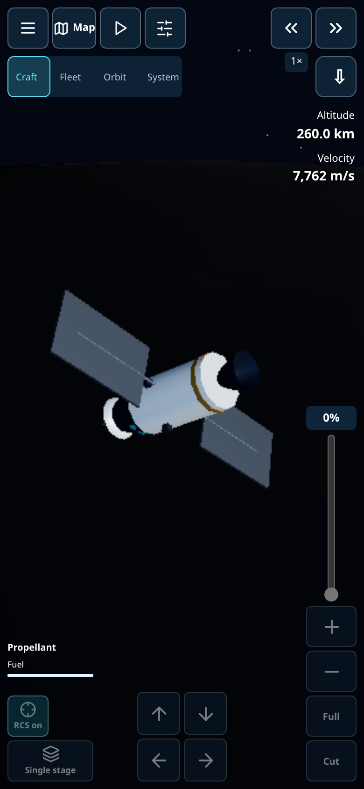
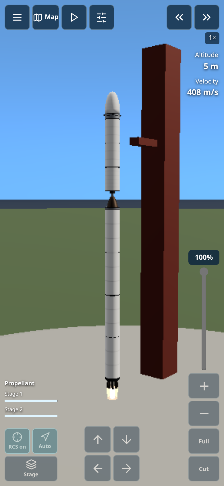
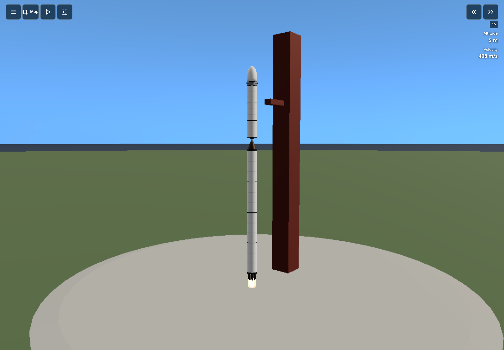

# Full-screen flight and mobile controls

Flight and exploration render edge to edge across the workspace. Controls float
over the scene; no top, bottom or side strip is reserved for them. Only the
buttons and throttle intercept gestures, so the open scene still supports camera
interaction. Button backgrounds use 80% opacity (20% transparency); icons and
text remain opaque and readable.

- Top left: Menu, Map, pause/resume and Instruments. Menu opens the existing
  tools, camera choices, saves and settings in a scrollable panel.
- Top right: time-speed controls, altitude and velocity. Exploration keeps
  Craft, Fleet, Orbit and System shortcuts and image capture accessible.
- Right edge: vertical throttle, incremental plus/minus, Full and Cut.
- Bottom: steering arrows, RCS, guidance, staging and propellant meters.
- Instruments open over the flight scene and close without resizing it.
  Exploration includes the destination selector and expandable world catalogue.
- Desktop uses the same flight menu with keyboard controls. Settings can show
  or hide touch controls independently of the camera and menu layout.

Handedness mirrors primary controls. Safe-area insets protect buttons from
notches and home indicators. Open menus remain scrollable on short screens.

The home page puts Mission, Explore, Quick First Orbit and Resume first. NASA
Data Explorer, Academy, Sandbox Lab and Mission Lab form a small discovery grid.
Challenges, Logbook, Guided Showcase, model comparison, data recovery, rocket
files, difficulty, tutorials, settings and offline preparation remain available.

The phone builder retains a blue drafting workspace, persistent parts rail,
3D/blueprint selection, quick mass/thrust/TWR values and expandable statistics.

## Verification

Serve the production build on port 8080 and start Chromium with remote debugging
on port 9222, then run from frontend:

```
npm run test:cockpit:ui
npm run test:controls
npm run test:mobile-visibility:ui
npm run test:ui
npm run test:labs:ui
```

The camera checks require it to fill its workspace with a clear centre and
reachable controls overlaid around its edges. They also check responsive home
navigation, touch throttle/steering, handedness, safe areas and keyboard-only
desktop use. These are Chromium emulation checks, not physical-device certification.

## Current screenshots










