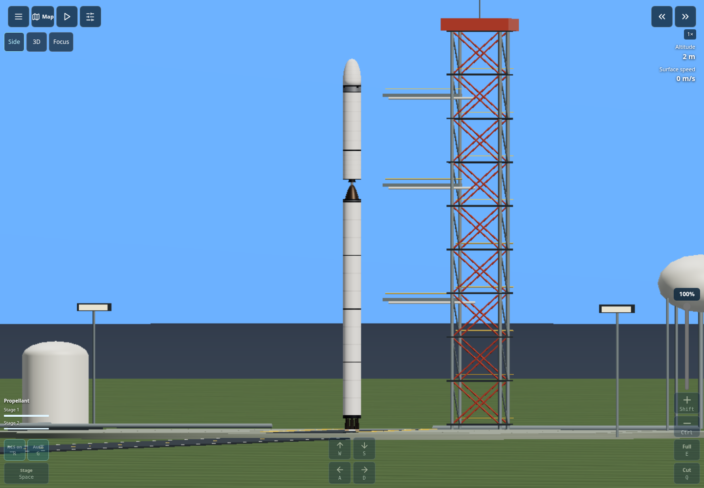

# Interaction update validation — 9 November 2026

The reference review and feature scope are in [sfs-reference-review.md](sfs-reference-review.md).
This document records automated checks; it does not claim physical device or
live deployment certification.

## Automated evidence

- Strict production build with `CI=true npm run build`.
- Full unit/simulation suite: **348 passed, zero failures**. Five new cases cover
  camera margins across portrait/landscape/desktop, polar camera bases,
  center-grip offsets for every part, recovery geometry/state independence and
  off-axis solid-booster placement.
- Construction studio browser check: complete blank-to-rocket native drag build,
  mirrored liquid boosters, working engines, two stages, legs/RCS, group editing,
  five layouts, safe-area insets, 3D preview and local resume.

The following browser suites exercise the production bundle through Chrome CDP:

| Command | Coverage |
| --- | --- |
| `npm run test:profile-view:ui` | Blank build, side/3D/map navigation, four viewports, true mobile DPR3 pinch/Focus, capsule recovery rendering fixture, recorded crash/rebuild/retry and exploration camera switch |
| `npm run test:placed-parts:ui` | Repeated/held taps on small, tall and side parts at 320/360/390 px portrait and 844 px landscape, DPR2/3, no large highlight or page zoom |
| `npm run test:assembly:mobile` | Native palette drag; tap-to-place rejected; outside drop cancellation; independent fingers; pinch; tall craft pan/zoom/Fit |
| `npm run test:magnets:ui` | Mouse/touch pre-release snapping, exact edge attachment, carried engines, thin selection and launch scenery |
| `npm run test:cockpit:ui` | Full-size canvas, edge controls, portrait/landscape/tablet/desktop, safe-area insets, simultaneous steering and throttle, instrument drawers and keyboard-only mode |
| `npm run test:controls` | Remapping, keyboard/touch/gamepad controls, modal release, throttle/staging/warp and pause behavior |
| `npm run test:assembly:ui` | Native side-booster build and grouping, persistence, desktop controls and custom rocket orbital flight |
| `npm run test:offline` | Prepared offline assets, navigation and recovery |

All eight listed browser suites passed. The separate construction-studio suite
also passed. No uncaught browser exceptions were recorded by these checks.
The focused profile suite also passed after the final map-return and asymmetric
framing refinements. A fresh Chromium session with SwiftShader and GPU
rasterization disabled was used for the final visual captures.

## Limits

Recovery appearance is tested with an explicitly seeded, paused capsule state;
that rendering check is not an independent physical reentry validation. Existing
entry and thermal simulation tests remain part of the full suite. Browser
emulation does not establish performance on every physical Android/iOS device.
The side camera does not change force models or make the simulation planar.

The restricted proxy prevented reviewing the current live Play Store/Steam
listing or verifying the Cloudflare deployment. Supplied footage was reviewed
with its mod/news/April-Fool limitations documented.

## Screenshots

[Phone side flight](images/reference-side-phone.png) ·
[Home](images/reference-home-desktop.png)
